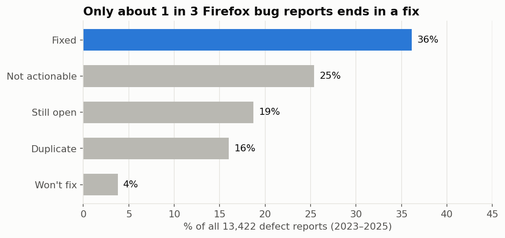
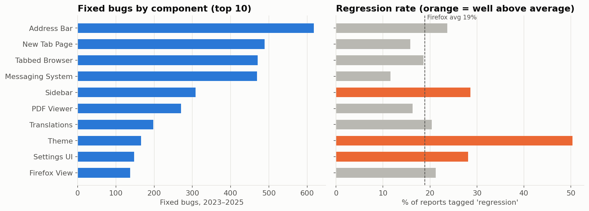
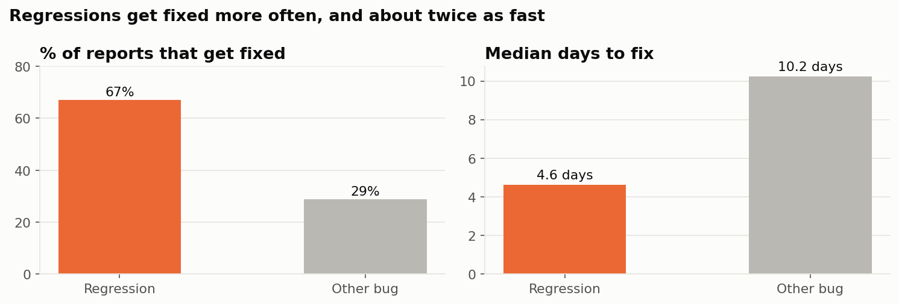
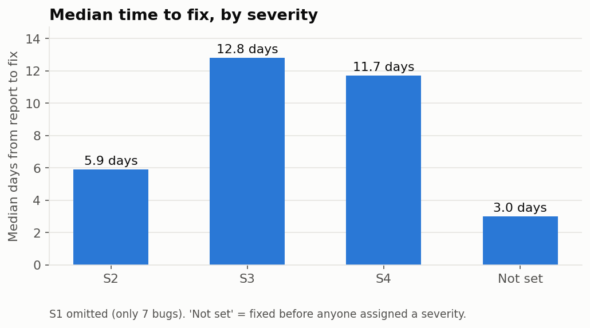

# Firefox Defect Analytics: Where Do Bugs Come From, and Where Should QA Focus?

An end-to-end analysis of **13,422 real Firefox defect reports (2023–2025)** from Mozilla's public Bugzilla,
looking at where bugs and regressions concentrate, how quickly different bugs get fixed, and where QA effort
would have the most impact.

I spent 3+ years as a QA engineer writing regression suites, validating data with SQL, and triaging defects
in Jira and TestRail. This project looks at the same problems from the data side.

**Tools:** Python (pandas, matplotlib, scikit-learn) · SQL (SQLite) · Jupyter · Bugzilla REST API

👉 **[Read the full analysis notebook](notebooks/defect_analysis.ipynb)**

---

## Key findings

### 1. Only about 1 in 3 bug reports ends in a fix


36% of reports were fixed, while **41% were duplicates or not actionable** (incomplete, invalid, couldn't reproduce).
That's a large share of triage time spent on reports that never become a code change.

### 2. Regression risk is concentrated in a few components


Address Bar and New Tab Page produce the most fixed bugs, but **Theme (~50%), Sidebar and Settings UI (~28%)**
have regression rates far above the Firefox average (~19%). Those components would benefit most from added
regression coverage.

### 3. Regressions get fixed more often, and twice as fast


Bugs tagged as regressions are fixed **67% of the time vs 29%**, with a median of **4.6 days vs 10.2**.
Once a regression is identified and linked to the change that caused it, it's easy to act on. That makes
a strong case for catching regressions early.

### 4. Severity drives speed, but only partly


S2 bugs are fixed about twice as fast as S3/S4, but **S3 and S4 take about the same time**. That suggests the
lower end of the severity scale isn't really affecting how work gets scheduled.

### 5. Other findings
- **Volume grew 43%** from 2023 to 2025 (3,721 → 5,303 reports/year).
- **~15% of all reports are flaky automated tests** (`intermittent-failure`); 64% of those close without a fix.
- **~2,500 bugs are still open**, with a median age of ~2 years; 832 have never been given a priority.

## Predicting which reports will get fixed

As a triage-helper experiment, I trained a model to predict whether a new report will end in a fix,
using **only information available at the moment it's filed** (component, OS, title text, whether a
bot filed it) to avoid data leakage.

| Model | Accuracy | Precision | Recall | F1 |
|---|---|---|---|---|
| Baseline (always "not fixed") | 0.556 | – | – | – |
| Logistic regression | 0.659 | 0.589 | 0.770 | 0.668 |
| **Random forest** | **0.669** | **0.596** | **0.792** | **0.680** |

The model catches ~79% of reports that really get fixed. That's useful for *ranking* incoming reports,
but not reliable enough to automate decisions. The notebook also flags one remaining leakage risk
(Bugzilla stores a bug's *current* component, not the one it was filed under).

## Recommendations

1. **Improve report quality at the source:** required repro steps/version/OS fields, plus duplicate search when filing.
2. **Target regression testing** at the highest-regression-rate components before each release.
3. **Quarantine and stabilise the flakiest automated tests** to cut CI noise.
4. **Review the S3/S4 split**, since it doesn't currently change fix speed.
5. **Run a quarterly backlog sweep**: close stale bugs and rate what remains.
6. **Pilot the model as a triage-ranking aid**, never as an auto-closer.

## Limitations
- Firefox is one product with its own triage process, so results may not generalise.
- Tags like `regression` and severity are applied by people, often after the fact.
- The resolved date is the *last* resolution, so reopened-then-refixed bugs show the final date.
- These are correlations, not causes.

## Project structure
```
├── data/
│   ├── raw/firefox_bugs_2023_2025.csv     # as downloaded from Bugzilla
│   └── clean/firefox_bugs_clean.csv       # cleaned, analysis-ready (also used for Power BI)
├── images/                                # charts used in this README
├── notebooks/defect_analysis.ipynb        # the full analysis (8 steps: access → recommend)
├── scripts/
│   ├── fetch_bugs.py                      # downloads the data from the Bugzilla API
│   └── build_notebook.py                  # generates the notebook
└── sql/queries.sql                        # key questions answered in SQL
```

## Reproduce it
```bash
pip install -r requirements.txt
python scripts/fetch_bugs.py          # re-download the data (optional; a copy is included)
jupyter notebook notebooks/defect_analysis.ipynb
```

## Data source
Mozilla Bugzilla public REST API: https://bugzilla.mozilla.org. Only public, non-personal fields were
collected (no reporter or assignee information).

---
**Stephanie Jivoderova** · [LinkedIn](https://linkedin.com/in/stephaniejivoderova)
